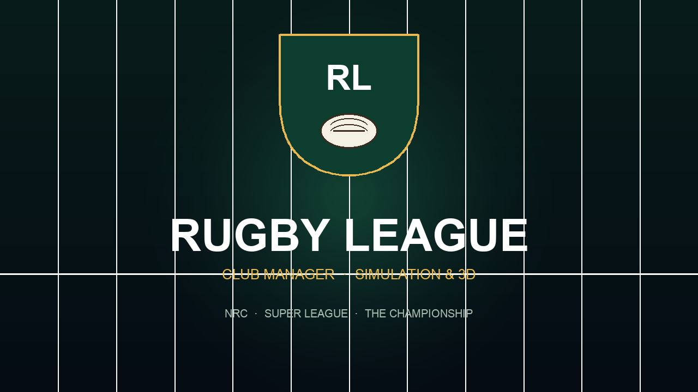

# Rugby League Club Manager

A MonoGame rugby-league management game for **Android 12+ (API 32+)** and **iOS 18+**, with a
desktop build for quick iteration. You run a club through a full season of league and cup rugby —
training, injuries, contracts, finances and sponsorship — and decide each week whether to watch the
match play out top-down as a skill-and-tactics simulation, or take the ball yourself in a
third-person, player-controlled match.

Every club, competition, sponsor and player is fictional. Names are only *evocative* of the real
competitions and clubs they are modelled on.



## What is in the game

**Management**

- Three competitions: the **National Rugby Championship** (17 clubs, Australia), **Super League**
  (12 clubs, England) and **The Championship** (12 clubs, tier two), each with a double round-robin
  season and a finals series for the top 8 / 6 / 4.
- The **Challenge Shield**, a knockout cup for all 41 clubs that runs alongside the league, one
  round every three weeks.
- **Promotion and relegation** between Super League and The Championship (one up, one down,
  decided by league position plus a play-off for the Championship challenger).
- Full squad management: 13-a-side lineups plus interchange bench, a "select best XVII" shortcut,
  player ratings, form, sharpness, morale, fitness, contracts and retirements.
- **Training** with seven focuses (balanced, fitness, attack, defence, handling, kicking, recovery),
  facility upgrades, youth-academy upgrades, age curves and overtraining injuries.
- **Injuries** with severities from knock to season-ending, weekly recovery, and selection that
  drops unavailable players automatically.
- **Finance**: balance, salary cap and spend, weekly wages, gate receipts, TV money, prize money,
  sponsor bonuses, ticket pricing and facility investment, with a transaction ledger.
- **Transfers**: transfer-listed players, free agents, bids, counter-offers, contract negotiations,
  a mid-season window that closes after round 8, and incoming bids for your own listed players.
- **Sponsorship**: main, sleeve, shorts, stadium-naming and kit-supplier deals with annual value,
  win bonuses, trophy bonuses, expiry and offers you accept or decline.
- News feed, board expectations and an end-of-season summary, with an autosave after every week.

**Two ways to play the match**

- **Top-down simulation** — every carry, kick, penalty, error, sin-bin and interchange is resolved
  from player attributes, the chosen formation, tactics sliders (kick early, offloads, line speed,
  width), team style, weather, home advantage and fatigue. Watch the animated 2D pitch, pause, change
  speed, or take the instant result.
- **3D player-controlled** — an arcade third-person match in the same style as a televised game.
  You control the ball carrier in attack and the nearest defender in defence; the rest of the side
  plays to the formation and tactics. Pass, kick, sprint and tackle with on-screen controls or a
  keyboard on desktop.

The rules follow the NRL / Super League law book closely enough to feel right: six-tackle sets,
10-metre retreat, four-point tries, two-point conversions and penalty goals, one-point drop goals,
40/20 kicks, goal-line drop-outs, sin bins, interchanges and golden point.

## Quick start

```bash
dotnet build src/RugbyLeague.DesktopGL
dotnet run --project src/RugbyLeague.DesktopGL
```

Requires the .NET 10 SDK and the MonoGame content builder tool (restored automatically by the
`MonoGame.Content.Builder.Task` package). Tests:

```bash
dotnet test tests/RugbyLeague.Core.Tests
```

Device builds, signing and deployment are covered in [docs/building.md](docs/building.md).

## Repository layout

| Path | Purpose |
| --- | --- |
| `src/RugbyLeague.Core` | MonoGame-free domain model, competitions, career loop, match engine and JSON save format. Fully deterministic per seed. |
| `src/RugbyLeague.Game` | Shared MonoGame game: screens, immediate-mode UI, virtual viewport, 2D and 3D rendering, all content. |
| `src/RugbyLeague.DesktopGL` | Desktop head for development. |
| `src/RugbyLeague.Android` | Android head (`net10.0-android`, min API 32). |
| `src/RugbyLeague.iOS` | iOS head (`net10.0-ios`, iOS 18+). |
| `tests/RugbyLeague.Core.Tests` | xunit tests for the simulation and career layer. |
| `tools/generate_assets.py` | Regenerates every raster asset: textures, app icons, splash screens, docs art. |
| `docs` | Architecture, gameplay, build and asset documentation. |

## Documentation

- [Architecture](docs/architecture.md) — projects, game loop, simulation pipeline, save format.
- [Gameplay](docs/gameplay.md) — the weekly loop, competitions, tactics, match modes, rules.
- [Building and signing](docs/building.md) — Android APK, iOS device builds, provisioning, deployment.
- [Assets](docs/assets.md) — what is generated, sizes, fonts and licences.

## Fictional names

All 41 clubs, every player, sponsor and brand in the game are invented. Club names use real cities
and regions with invented nicknames (for example *Brisbane Stallions*, *Wigan Legion*) so the
competitions feel familiar without copying any real club's identity, badge, colours or sponsor. See
[the notice in the gameplay docs](docs/gameplay.md#fictional-clubs-and-players).

## Licence

Source code is provided for personal use. The bundled Open Sans font is licensed under the SIL Open
Font License; the licence text ships in `src/RugbyLeague.Game/Content/Fonts/OFL.txt`.
